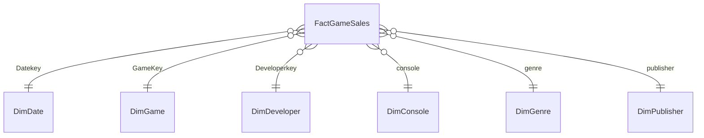

# 🎮 GameVerse – Video Game Sales Analytics


An interactive, neon-themed **Power BI dashboard** analysing global video game sales (**1980 – 2024**) by platform, genre, publisher, region and release year. The project is stored as a **Power BI Project (PBIP)** so the report (PBIR/JSON) and the semantic model (TMDL) are fully version-controllable with Git.

---

## 📌 Highlights

- **5-page report** with custom page backgrounds, page-navigation buttons and synced slicers
- **Star-schema semantic model** built in Power Query (1 fact table, 6 dimensions)
- **25+ DAX measures**: totals, regional sales, YoY growth, market share, top-N (genre / publisher / platform), dynamic text takeaways
- **Source-control friendly**: no `.pbix` binary – every visual and table is a text file

## 🖼️ Dashboard pages

| Page | Purpose |
|---|---|
| **1. Overview** | Total sales, total games, average critic score, sales trend, regional split, sales by genre / console / publisher |
| **2. Sales** | Year · Genre · Platform · Publisher slicers, YoY growth, market share, treemap, critic-score vs sales scatter |
| **3. Games** | Games and genres count, average / highest critic score, titles per year, critic-score distribution |
| **4. Platform** | Total platforms, leading platform sales, market share, best-selling platform, platform trends and regional sales per platform |
| **5. Insights** | Headline KPIs and four data-driven key takeaways (peak year, top genre, top platform, top publisher) |

> 📷 Add screenshots in `docs/images/` and reference them here, e.g. ``

## 🧱 Data model



Full table, relationship and measure reference: [`docs/DATA_MODEL.md`](docs/DATA_MODEL.md)

## 🛠️ Tech stack

Power BI Desktop · Power Query (M) · DAX · TMDL · PBIR · Git / GitHub

## 📁 Repository structure

```
VT.pbip                 Entry point – open in Power BI Desktop
VT.Report/              Report definition (PBIR): pages, visuals, theme, backgrounds
VT.SemanticModel/       Semantic model (TMDL): tables, relationships, measures
docs/DATA_MODEL.md      Data model & measure documentation
CHANGELOG.md            Fixes and additions
```

## 🚀 Getting started

1. Install the latest **Power BI Desktop** (Windows).
2. Clone this repository and open **`VT.pbip`**.
3. Get the source CSV (`Assignment 4 - Video Games Sales (1980-2024) - Raw.csv`) – it is not included in the repo.
4. In **Transform data → Advanced Editor**, update the `File.Contents(...)` path in `FactGameSales`, `DimGame`, `DimConsole`, `DimGenre`, `DimPublisher`, `DimDeveloper` and `DimDate`.
5. Click **Refresh**.

## 🔧 Lessons learned / key fixes

- **Empty date charts:** the fact table's `release_date` was text while `DimDate[release_date]` was a date, so the merge never matched and every `Datekey` was null. Fixed by computing a `yyyymmdd` integer `Datekey` on both sides.
- **Duplicate dates in `DimDate`:** rebuilt as one row per distinct date with year / quarter / month / day columns.
- **Invalid measure:** removed a `SUM` over a text column.
- **Navigation:** corrected page-navigation targets.

See [`CHANGELOG.md`](CHANGELOG.md) for details.

## 📚 Official documentation

- [Power BI Desktop projects (PBIP)](https://learn.microsoft.com/power-bi/developer/projects/projects-overview)
- [Project report folder (PBIR)](https://learn.microsoft.com/power-bi/developer/projects/projects-report)
- [Enhanced report format (PBIR)](https://learn.microsoft.com/power-bi/developer/projects/projects-enhanced-report-format)
- [Project semantic model folder (TMDL)](https://learn.microsoft.com/power-bi/developer/projects/projects-dataset)
- [TMDL overview](https://learn.microsoft.com/analysis-services/tmdl/tmdl-overview)
- [Power BI projects & Git integration](https://learn.microsoft.com/power-bi/developer/projects/projects-git)
- [Star schema guidance](https://learn.microsoft.com/power-bi/guidance/star-schema)
- [DAX reference](https://learn.microsoft.com/dax/)

## 🔮 Possible improvements

- Replace the hardcoded CSV path with a Power Query parameter
- Add a calendar-table `DimDate` marked as a date table
- Add row-level tooltips and drill-through to a game-detail page
- Publish to Power BI Service with scheduled refresh

## 👤 Author

**<Your Name>** · [LinkedIn](https://www.linkedin.com/in/<your-handle>) · [GitHub](https://github.com/<your-username>)
